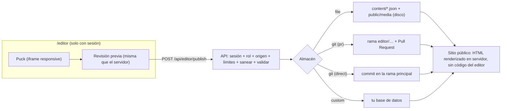

# Editor visual — guía del proyecto

Todo sitio nuevo creado con `/init-client` incluye el módulo `visual-editor` (se omite con `--no-editor`). Este documento explica qué puede hacer el cliente, cómo se publica, cómo se protege y **qué no está verificado**.

## Qué puede hacer el cliente (en `/editor`)

| Necesidad | Cómo se hace |
|---|---|
| Ver y editar en **móvil, tablet y escritorio** | Botones de tamaño del editor (390 / 820 / 1280 px). La vista previa es un iframe con el ancho real, así que las _media queries_ responden igual que en el sitio publicado. |
| Cambiar **textos** y **estructura** | Se selecciona un bloque y se edita en el panel derecho; el cambio se ve al instante. Se añaden, duplican, mueven y borran bloques arrastrando. |
| **Imágenes**: añadir, cambiar, quitar | Campo «Imagen» de cada bloque: subir, elegir de la biblioteca o quitar. Se optimizan solas (WebP, 480/960/1600 px, sin metadatos). Máx. 4 MB por imagen; JPG, PNG, WebP o AVIF (no SVG). |
| **Colores**, **tipografía**, esquinas, espaciado, ancho | Botón «Diseño»: esquemas listos o colores propios, 6 tipografías, forma de las esquinas, espaciado y ancho. Cambios en vivo. El **contraste WCAG AA (4.5:1) se vigila solo** y bloquea el guardado si algún par es ilegible. |
| **Cabecera, logotipo, menú y pie** (componentes globales) | Página «Cabecera y pie (todo el sitio)». Aparecen en todas las páginas y, en solo lectura, alrededor de la página que se edita. |
| **Páginas nuevas** | Solo administradores («Crear página»). |
| Título y descripción para **buscadores** | Panel de página (sin bloque seleccionado). |
| **Revisión antes de publicar** | Panel «Revisión»: un único título principal, títulos en orden, texto alternativo en imágenes, peso de imágenes, enlaces con texto, longitud SEO. Los errores bloquean; los avisos no. |

Bloques disponibles: Cabecera, Portada (único `h1`), Características, Logotipos, Texto, Imagen, Preguntas frecuentes (con datos estructurados `FAQPage`), Llamada a la acción, Pie y Espacio. Para añadir uno: esquema en `lib/blocks/schemas.ts`, componente en `components/blocks/blocks.tsx` y campos en `app/editor/puck-config.tsx`; las pruebas existentes (esquemas, sin atributos `style`, un solo `h1`) se aplican solas.

## Cómo funciona

- **El contenido son archivos JSON** (`content/pages/*.json`, `content/site-layout.json`, `content/theme.json`, `content/media.json`) validados con zod. Un archivo dañado nunca rompe el sitio: se omite el bloque o se usa el tema por defecto.
- **La web pública no importa Puck.** La pinta `lib/content/render.tsx` con componentes sin estado ni hooks; hay una prueba e2e que busca código del editor en los scripts de la página pública. Resultado: HTML semántico (cabecera, `main`, pie, títulos, listas) igual para personas, buscadores y agentes de IA, sin depender de JavaScript.
- **El tema** vive en `content/theme.json` y se sirve como archivo `/theme.css` con la huella en la URL (`?v=…`, caché inmutable). No usa `<style>` en línea: funciona con la CSP estricta con nonce.
- **Sin atributos `style` en el sitio público** (los bloques solo usan clases y variables del tema); una prueba lo comprueba.

## Cómo se publica

| `EDITOR_STORE` | Dónde se guarda | Cuándo usarlo |
|---|---|---|
| `file` (por defecto) | Disco del servidor (`content/`, `public/media/`). Se ve al instante (`revalidatePath`). | VPS/Docker con **disco persistente** (volumen). **No** en hosting sin disco persistente (Vercel, serverless): lo escrito se pierde. |
| `git` + `EDITOR_PUBLISH_MODE=pr` | Rama `editor/…` y **Pull Request** vía API de GitHub. El cambio sale al fusionarlo (con vista previa y revisión). | **Recomendado en producción.** Historial, revisión y reversión gratis. |
| `git` + `direct` | Commit en la rama base. | Equipos pequeños que aceptan publicar sin revisión. |
| `custom` | Tu implementación de `ContentStore` (`lib/content/store-custom.ts`). | Base de datos / varios editores concurrentes. Ver `ESCALABILIDAD.md`. |

El token de GitHub (`EDITOR_GITHUB_TOKEN`) debe ser de **grano fino, limitado a este repositorio**, con _Contents_ y _Pull requests_ en lectura/escritura, y con **fecha de caducidad anotada** (calendario de renovación). Solo vive en el gestor de secretos del proveedor.

Las imágenes nuevas viajan con la página que las usa (no se escriben al subirlas): contenido e imágenes salen en un mismo cambio revisable. El cuerpo de una publicación está limitado a 4 MB (límite habitual de funciones serverless: 4,5 MB): si una página nueva trae muchas imágenes grandes, publica por partes.

## Acceso (enlace mágico) y roles

1. La persona escribe su correo en `/editor`. La respuesta es **siempre la misma** exista o no el correo.
2. Si está en `EDITOR_ALLOWED_EMAILS`, recibe un enlace (15 min) **atado al navegador que lo pidió** (cookie HttpOnly con un nonce) y de un solo uso.
3. Al abrirlo en ese navegador se crea una sesión de 8 h (cookie `HttpOnly`, `SameSite=Lax`, `Secure` con HTTPS; con HTTPS usa el prefijo `__Host-`).

Roles (`EDITOR_ALLOWED_EMAILS="ana@cliente.com:admin,luis@cliente.com"`): **editor** edita páginas existentes, cabecera/pie e imágenes; **admin** además crea y borra páginas y guarda el diseño. Quitar un correo de la lista corta el acceso al instante (se comprueba en cada petición).

Medidas: firma HMAC-SHA256 con claves derivadas distintas para enlace y sesión (no intercambiables), comparación en tiempo constante, límite de intentos por IP y por correo, verificación de `Origin` en toda petición que modifica estado, registro de auditoría (correo en forma de huella), lista cerrada de rutas escribibles, HTML de texto enriquecido saneado en servidor al publicar **y** al pintar, imágenes validadas por sus primeros bytes y re-procesadas (SVG rechazado), CSP: solo `/editor` admite estilos en línea.

## Variables de entorno

| Variable | Obligatoria | Nota |
|---|---|---|
| `EDITOR_SESSION_SECRET` | sí | ≥ 32 caracteres aleatorios (`node -e "console.log(require('crypto').randomBytes(32).toString('base64url'))"`). Rotarlo cierra todas las sesiones. |
| `EDITOR_ALLOWED_EMAILS` | sí | Sin ella `/editor` queda desactivado (falla cerrado). |
| `EDITOR_MAIL_FROM`, `RESEND_API_KEY` | sí | Dominio de envío verificado en Resend (SPF/DKIM). |
| `EDITOR_STORE`, `EDITOR_PUBLISH_MODE` | no | `file` / `pr` por defecto. |
| `EDITOR_GITHUB_REPO`, `EDITOR_GITHUB_TOKEN`, `EDITOR_GITHUB_BRANCH` | con `git` | Ver arriba. |
| `EDITOR_MAIL_DRIVER=outbox` | solo pruebas | Guarda el enlace en `.web-os/state/`; **se rechaza** con `NEXT_PUBLIC_SITE_ENV=production`. |

## Verificado y NO verificado

Verificado (proyecto de prueba aislado, con y sin los 8 módulos, incluido `strict-csp`): tipos, lint, formato, pruebas unitarias, build, e2e en Chromium (vistas de móvil/tablet/escritorio, edición y publicación reales, subida de imágenes, cambio de tema en vivo y bloqueo por contraste, enlace mágico completo incluida su atadura al navegador, CSRF, 401/403, consola sin errores ni violaciones de CSP, axe sin violaciones serias en las pantallas propias), Lighthouse móvil y `npm audit`. Las cifras están en `docs/decisions/ADR-0002-editor-visual.md`.

**No verificado** (ver también `docs/audit/AUDITORIA.md` del sistema):

- El almacén `git` está probado contra un **servidor simulado**; no se ha ejecutado contra la API real de GitHub. Haz una publicación de prueba en un repositorio de ensayo antes de entregarlo.
- El envío real con Resend (dominio verificado, entrega, spam) depende del dominio del cliente.
- La **interfaz de Puck** (barras laterales, «Blocks», «Outline», arrastre) es de terceros: está en inglés en parte y no se ha auditado su accesibilidad; nuestras pantallas (acceso, barra superior, diseño, revisión) sí pasan axe. El editor está pensado para ratón/táctil con pantalla ≥ 1024 px; en móvil no se ha probado.
- El enlace mágico es una **autenticación propia**: se recomienda una revisión de seguridad independiente antes de dar acceso a clientes reales. El límite de intentos y la lista de enlaces usados están **en memoria**: en varias instancias, cada una cuenta aparte (ver `ESCALABILIDAD.md`).
- Dos personas editando a la vez la misma página: gana la última publicación (con `git` + `pr`, las diferencias se resuelven al fusionar).
- Posicionamiento en buscadores: el editor y la plantilla cubren los **requisitos técnicos** (HTML semántico, metadatos, sitemap, datos estructurados, rendimiento), pero **ningún sistema puede prometer posiciones**.
